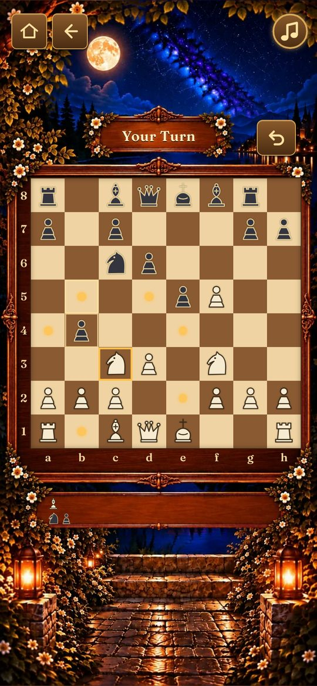
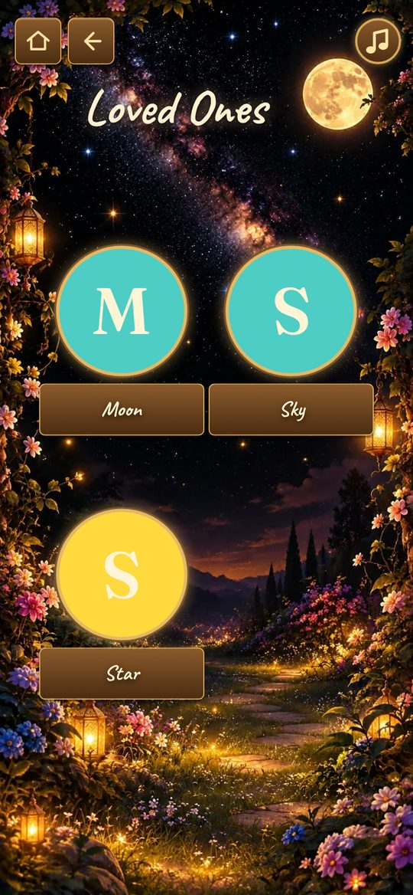
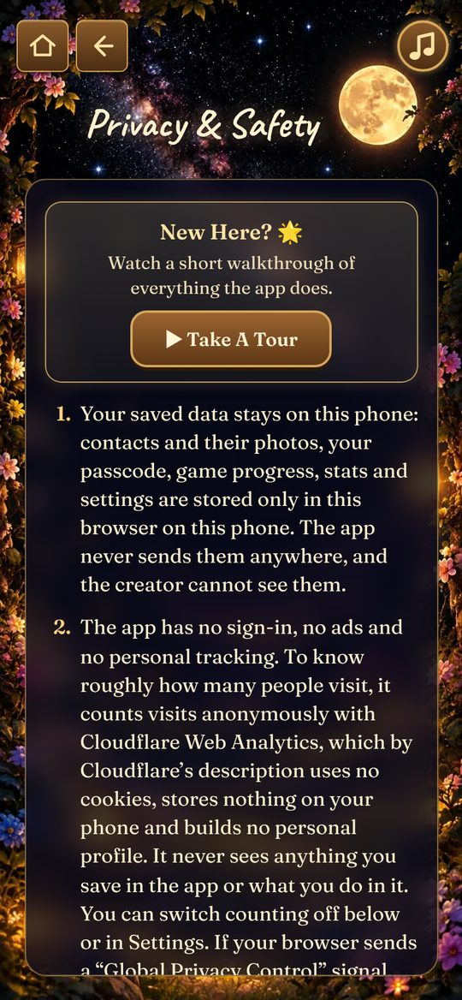
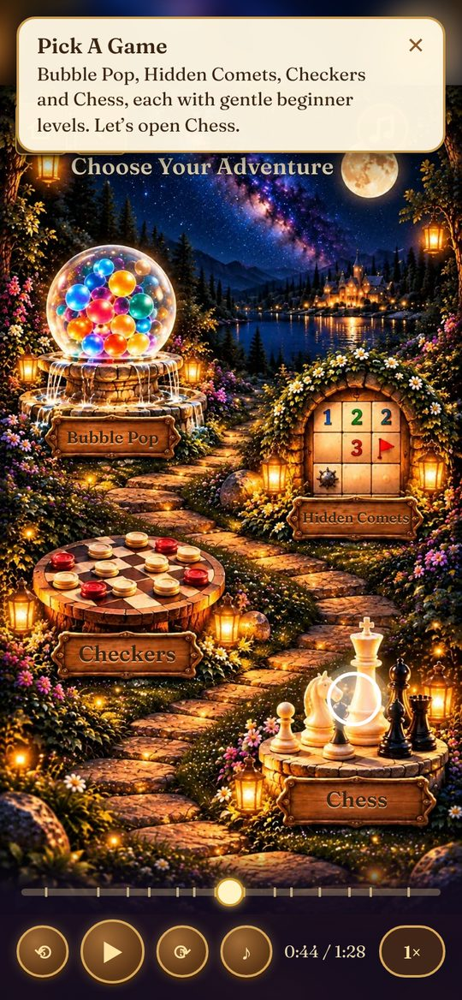

# Taarala Thota · Garden of Stars

**A calm, ad-free garden of games and a private shortcut to the people who matter.**
No sign-in. No ads. Everything you save stays on your own phone.
Built because free game apps are full of ads and pop-ups that one accidental tap can open.

**[▶ Try it](https://taarala-thota.pages.dev)** · **[Watch the tour](#watch-the-tour)** · **[Product documentation (PDF)](docs/Taarala_Thota_Product_Documentation.pdf)**

## Watch the tour

A 1½-minute walkthrough of everything the app does ([download the video](docs/media/Taarala_Thota_Tour.mp4)).

https://github.com/user-attachments/assets/24a0f804-09ca-4239-8799-a80cb110cdca

## Highlights

- **Live and installable** at taarala-thota.pages.dev since 28 October 2026, after starting as a private family app in
  February 2026.
- **Eleven small, approved releases in its first week.** I approved each one, including the exact "What's New"
  wording people see before they update.
- **29 automated test suites with more than 420 checks**, plus testing on real Android and iPhone devices.
- **67 product decisions logged** with the options considered and the trade-off accepted.
- **Privacy by design:** no accounts and no server for personal data; $0 a month to host.

## My role and how I worked with AI

I'm a product manager. I defined the product, wrote the requirements, made every product, privacy and design decision,
tested on real phones, and approved every release. The code was written by an AI coding assistant (Claude, by
Anthropic) to my requirements. A second AI (ChatGPT) reviewed each release package and created most of the painted
artwork. The app itself doesn't use AI; AI was used to build it.

**How I directed the work**
- Requirements written as outcomes, for example "a stray tap must never leave the app".
- Options and trade-offs, then mockups, before anything was built; nothing changed without my approval.
- One approved step at a time: test branch → protected preview → my review on real devices → my approval → release.

**Examples of the judgment involved**
- I insisted the Privacy & Safety page separate what the app keeps (nothing leaves your phone) from what any website's
  host handles, rather than making a simpler "no data at all" claim.
- I rejected the first guided tour (step-by-step cards) and asked for a walkthrough that plays on the real screens,
  with pause, speed and a bar to go back or forward.
- My own use caught problems every automated test had passed: Settings stayed unlocked after leaving it, and the app
  wouldn't reopen on the live host. Both were fixed, with new tests added.

**Limits of this approach.** It's inspired by the maker-checker control I know from financial services, not
equivalent to an audited one: both AI models can be wrong in similar ways, and the automated tests were written by the
same AI that wrote the code. The independent controls were my own testing on real devices and my approval of every
release. None of this is a professional security, privacy or legal certification.

**What I learned:** AI made building dramatically faster, but quality came from clear requirements, explicit
trade-offs, strict acceptance and testing on real devices.

The full story (requirements, decisions, testing, privacy and risk) is in the
**[product documentation](docs/Taarala_Thota_Product_Documentation.pdf)**.

## What it does

  
  
  
  
  

- **Four games:** Bubble Pop, Hidden Comets (a gentle take on minesweeper), Chess and International Checkers, each with
  beginner levels. Chess and Checkers show move hints and allow undo on Easy.
- **Loved Ones:** a short, private list of chosen people. One tap opens WhatsApp to message or call them; nothing is ever
  sent automatically.
- **Private by design:** contacts, progress and settings stay on the phone, protected by a Settings passcode, with
  optional password-locked backups. Visits are counted anonymously (no cookies) and can be switched off.
- **Steady:** stray taps, long presses and swipes don't throw you out of the app.
- **Take A Tour:** a 1½-minute walkthrough that plays on the real screens and shows where to tap.
- **Works offline** and installs like an app. Updates wait until you choose, after showing what's new.

## Why I built it

Taarala Thota started as a public offshoot of a private family app I'd been building since February 2026. I was looking
for safe, calm games for my family and kept finding free apps full of ads and banners, where one accidental tap opened a
pop-up, a video or a store page, which often led to another. I wanted a space where that simply couldn't happen. The idea
then grew to include a focused way to reach a few chosen loved ones.

## About this project

Taarala Thota is a personal, non-commercial learning project. It's free, has no ads and isn't for sale. I've worked hard
to protect privacy and get things right, but I'm not a legal or security professional, and there may be mistakes. If you
notice anything that could cause harm, please tell me through Share Feedback and I'll fix it as quickly as I can.

## Install and use it

<b>Install it on your phone (optional)</b>

It's an installable web app: no app store, free, and it takes a few seconds.

- **Android (Chrome):** open the link → tap **⋮** → **Add to home screen** → choose **Install** (not "Create shortcut",
  which only opens a browser tab). If the menu shows **Install app**, tap that.
- **iPhone (Safari):** open the link → open the **Share** menu (on some iPhones it's under **⋯**) → find
  **Add to Home Screen** (you may need to scroll down) → **Add**.

Menus can look slightly different depending on your phone and browser version. On iPhone, the installed app keeps its
own data separate from Safari, so if you saved anything in Safari first, back it up there and restore it in the
installed app.

<b>How to use it</b>

1. **Open it** at **taarala-thota.pages.dev**, best on a phone. A short welcome note explains privacy; tap **Got It**.
2. **Add your loved ones:** tap the **gear** (top right of Home) → create a **passcode** → **+ Add A Contact**.
3. **Reach them:** tap the **Family** door → tap a person's circle → WhatsApp opens to message or call.
4. **Play:** tap the **Play** door and choose a game. On **Easy**, Chess and Checkers show move hints and let you undo.
5. **Keep your data safe:** everything stays on your phone, so make a backup now and then (gear → **Back Up Now**).
6. **Stay up to date:** when a new version is ready, a gold **↑ Update** button appears. See **What's New**, then update
   whenever it suits you.
7. **Share your thoughts:** **Privacy & Safety** or **Settings** → **Share Feedback (Anonymous)**.

New here? **Privacy & Safety** or **Settings** → **▶ Take A Tour**.

## For developers

See **[docs/DEVELOPER_GUIDE.md](docs/DEVELOPER_GUIDE.md)**: plain HTML, CSS and JavaScript, one small build step,
automated browser tests, hosted on Cloudflare Pages. Release notes are in **[CHANGELOG.md](CHANGELOG.md)**.

## Credits and licence

© 2026 Rukmini Gandepalli (@rdg-git). All rights reserved. See **[LICENSE](LICENSE)**.
Fonts: Caveat and Fraunces (SIL Open Font License). Pictures: made with AI image tools, mostly ChatGPT, with some by
Claude, under my direction. The Loved Ones screenshot and the tour video use made-up example contacts.

Made by **Rukmini Gandepalli (@rdg-git)** · [LinkedIn](https://www.linkedin.com/in/rukminigandepalli/)
