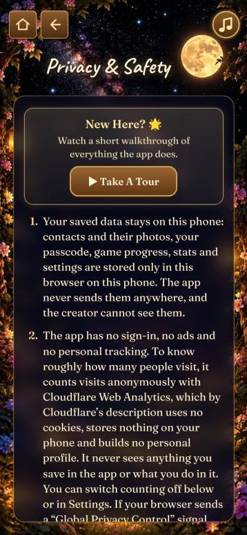
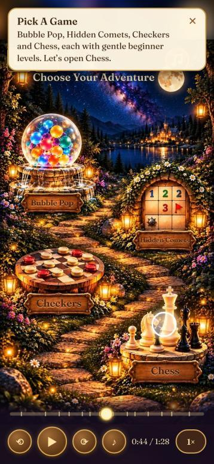
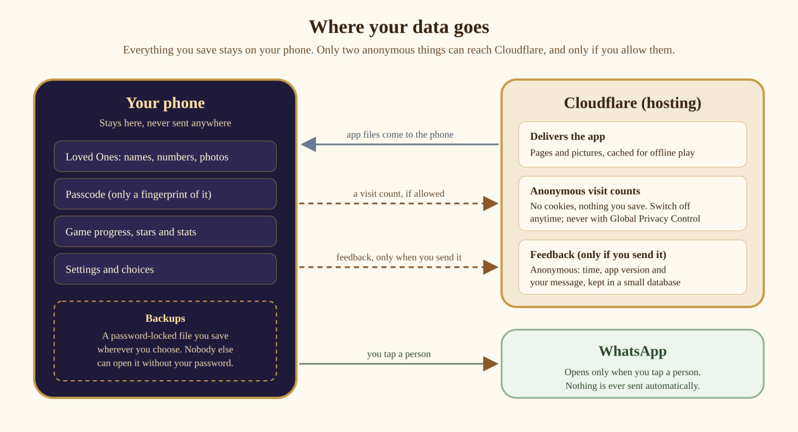

# TAARALA THOTA

A Garden Of Stars

OCTOBER 29, 2026

RUKMINI GANDEPALLI (@RDG-GIT)

[**taarala-thota.pages.dev**](https://taarala-thota.pages.dev/)

---

## Taarala Thota · Garden of Stars

A calm, ad-free garden of games and a private shortcut to the people who matter, built as an installable web app. Live at [taarala-thota.pages.dev](https://taarala-thota.pages.dev/) · October 2026

This document is written for product, design and engineering readers. Each section stands on its own; use the outline to jump between them.

## About This Project

Taarala Thota is a personal, non-commercial learning project. It’s free, has no ads and isn’t for sale. I’ve worked hard to protect privacy and get things right, but I’m not a legal or security professional, and there may be mistakes. If you notice anything that could cause harm, please tell me through Share Feedback and I’ll fix it as quickly as I can.

## Index

1. [Product Case Study](#1-product-case-study)
2. [Product Requirements Document (PRD)](#2-product-requirements-document-prd)
3. [AI-Assisted Development Methodology](#3-ai-assisted-development-methodology)
4. [Product Roadmap and Prioritization](#4-product-roadmap-and-prioritization)
5. [UX Design and User Journeys](#5-ux-design-and-user-journeys)
6. [Product Architecture and Decision Records](#6-product-architecture-and-decision-records)
7. [QA and Validation Report](#7-qa-and-validation-report)
8. [Privacy, Security and Risk Assessment](#8-privacy-security-and-risk-assessment)
9. [Product Decision Log](#9-product-decision-log)

---

## 1. Product Case Study

### At a Glance

- **Try it:** [taarala-thota.pages.dev](https://taarala-thota.pages.dev/) (best on a phone)
- **See it:** a 1½-minute tour video, in the README
- **Code and history:** [github.com/rdg-git/taarala-thota](https://github.com/rdg-git/taarala-thota)

**Key decisions**

1. **Everything stays on the phone:** no accounts and no server for personal data; locked backups instead of cloud sync.
2. **Settings protected by a passcode:** games and loved ones stay one tap away, numbers stay private.
3. **The person chooses when to update,** after seeing exactly what’s new; never during play.
4. **Anonymous visit counting with a clear notice,** an easy off switch, and Global Privacy Control respected.
5. **Nothing reaches the live app untested:** test branch, protected preview, and my approval of every change and its wording.
6. **A playing tour on the real screens** instead of a manual: a few KB, works offline, never out of date.

### Summary

| | |
|---|---|
| **Product** | Taarala Thota (Garden of Stars): An installable web app (Progressive Web Application) with four classic games with gentle beginner levels, a private “Loved Ones” shortcut to message or call chosen people on WhatsApp, and a built-in guided tour (Take A Tour). |
| **Platform** | Installable web app (PWA): works in any phone browser, installs to the Home Screen, works offline |
| **My role** | Product manager: ideation, problem, requirements, every product, privacy and design decision, acceptance and release approval |
| **How it was built** | AI-assisted: Claude (Anthropic) wrote the code to my requirements; ChatGPT reviewed the work as a second model (inspired by maker-checker); I decided |
| **Timeline** | Private family version from February 2026; public version complete 23 Oct 2026; live 28 Oct 2026; eleven approved releases by 29 Oct 2026 |
| **Quality** | 29 automated test suites (more than 420 checks), a security review with an attack test, and real-phone testing on a protected preview before release |

### Background

Taarala Thota started as a public offshoot of a private family app I’d been building since February 2026. I was looking for safe, calm games for my family and kept finding free apps full of ads and banners, where one accidental tap opened a pop-up, a video or a store page, which often led to another. I wanted a space where that simply couldn’t happen. The idea then grew to include a focused way to reach a few chosen loved ones. Taarala Thota is that idea, made public: no ads, no sign-in, nothing personal collected.

### The problem

Free game apps are rarely calm. Most are paid for by advertising, and a single accidental tap opens a pop-up, a video or an app-store page. Many ask for an account and collect personal data. At the same time, reaching the people who matter most usually means digging through a crowded contact list. This was my family’s need.

### What I knew and what I assumed

- **Observed first-hand:** before building, I downloaded several free games from the Google Play Store, mostly bubble-pop games and piano games that turn the screen into keys. Every one had either sudden pop-ups that could be tapped by accident or ad banners, so I could never hand the phone over and walk away.
- **Assumed:** other people want the same calm, ad-free space.
- **Assumed:** a short, private list of loved ones is valuable alongside the games.
- **Not yet validated:** whether people outside my family find it useful, and which games matter most to them.
- **How I’ll validate:** feedback after launch, and watching a few people try it for the first time (see Success measures).

This is a personal, non-commercial project, so I didn’t run formal customer research. I’ve kept what I observed separate from what I assumed.

### The solution

A garden that opens straight onto two doors, **Play** and **Family**:

- **Play**: Bubble Pop, Hidden Comets (a gentle take on minesweeper), Chess and International Checkers. Every game has easy beginner levels; Chess and Checkers offer hints and undo on Easy, so anyone can learn.
- **Family (Loved Ones)**: up to 20 chosen people as large circles with photos. One tap opens WhatsApp to message or call.
- **Privacy:** Nothing to sign up for, nothing personal collected: no account, no ads, no personal tracking. Everything you save stays on the phone, protected by a Settings passcode and optional password-locked backups. Visits are counted anonymously (no cookies) and can be switched off.
- **Steady**: stray taps, long presses and swipes never throw you out of the app.
- **Take A Tour**: a 1½-minute walkthrough that plays on the real screens and shows where to tap, with pause, speed and a bar to go back or forward.

  

*Choose Your Adventure · Chess on Easy with move hints · Privacy & Safety*

### Outcome

- Live and installable, with a test-then-release process: every change is tested on a protected preview before it reaches the live app, and people see exactly “What’s New” before they choose to update.
- A product with no personal data to leak by design apart from anything people choose to type into feedback (see Feedback content), an honest privacy page, and documented, disclosed limitations.
- A public repository showing the full history of decisions, tests and releases.
- Anonymous visit counts and an in-app feedback box show whether it’s working, without tracking anyone.

### What I learned

AI made execution dramatically faster, but quality came from the product discipline around it: clear requirements, explicit trade-offs, strict acceptance criteria, an independent checker, and testing on real devices. Two of the most important defects were found by my own real-world use after all automated tests had passed.

---

## 2. Product Requirements Document (PRD)

### Goals

1. Offer calm, constructive play with no ads, no sign-up and no personal tracking.
2. Put the people who matter one tap away, privately.
3. Keep every piece of personal data on the person’s own phone, under their control.
4. Be usable by anyone, including beginners, without instructions.

### Non-goals (for this version)

- Accounts, cloud sync or server-side storage of personal data
- Playing against other people online.
- Advertising of any kind.
- App-store distribution (it is an installable web app).
- Personal tracking or analytics of what people do inside the app.

### Who it is for

| Person | What they need | Focus |
|---|---|---|
| Someone who wants a few good games without ads | Open and play in two taps; nothing interrupts | Primary |
| A beginner learning chess or checkers | Easy levels, move hints, undo | Secondary |
| Someone who wants their closest people one tap away | A short, private list that opens WhatsApp directly | Primary |
| Someone sharing their phone with another person | Settings and numbers protected; the screen stays in the app | Secondary |
| Someone new to the app | Take A Tour shows where to tap in about 1½ minutes | Secondary |

The primary focus is calm play and reaching loved ones quickly, for myself and my family first. The other needs are secondary, and the app stays open to everyone.

### Functional requirements and acceptance criteria

| # | Requirement | Accepted when |
|---|---|---|
| F1 | Open straight to Home, no sign-in | First visit shows Home with Play and Family; no prompts |
| F2 | Four games with beginner levels | Each game playable end to end; Bubble Pop levels all open; accuracy goals earn gold stars |
| F3 | Hints and undo on Easy only | Hints/undo appear on Easy in Chess and Checkers, never on harder levels |

| # | Requirement | Accepted when |
|---|---|---|
| F4 | Loved Ones: one tap to WhatsApp | Tapping a person opens WhatsApp for that number; nothing is sent automatically |
| F5 | Settings protected by a passcode | Numbers can only be seen or changed after the passcode; Settings locks when you leave it and after 10 minutes without a tap in Settings |
| F6 | Forgot passcode | Typing ERASE removes saved contacts and the passcode only; games and progress stay |
| F7 | Backup and restore | Backup creates a password-locked file; restore checks every item and keeps the current passcode |
| F8 | Backup reminder | Shown on Home only, every 6 days once there is something to save |
| F9 | Works offline | After the first visit, the app opens and plays without internet |
| F10 | Updates never interrupt | A new version waits; the person sees “What’s New” and chooses Update Now or Later; a small “Update” button and Settings let them update any time; never during play |
| F11 | Privacy & Safety page | Plain-language points, including what the hosting service handles, how to keep data safe, and the official address |
| F12 | Laptop visitors | A welcome card offers a QR code to open on a phone, or Continue On This Screen |
| F13 | Phone turned sideways | A calm “turn upright” card appears and Bubble Pop pauses |
| F14 | Anonymous visit counting | Counted only on the official address and only after the one-time welcome note; switch on Privacy & Safety and in Settings, every change confirmed; never counted when the browser sends Global Privacy Control |
| F15 | Anonymous feedback | One box from Privacy & Safety or Settings; only the message and app version are sent; 10,000-character limit; daily cap |
| F16 | Take A Tour | Starts from the top of Privacy & Safety and from Settings; plays on the real screens with pause, 5-second back/forward, drag bar, speed and music; nothing is tapped or saved; install steps match the phone |

### Non-functional requirements

| Area | Requirement |
|---|---|
| Privacy | Nothing you save leaves the phone; no cookies; visit counts are anonymous and can be switched off; feedback is anonymous |
| Security | Strict browser security rules; no outside code except Cloudflare’s anonymous counting script, loaded only when counting is on; passcode never stored, only a fingerprint; backups encrypted |

| Area | Requirement |
|---|---|
| Reliability | Data kept across updates; app reopens reliably online and offline |
| Performance | About 1 MB to open Home; pictures in modern compressed formats |
| Accessibility | Finger-sized buttons (44 px minimum), screen-reader labels, reduced motion respected, two-finger zoom on text pages |
| Maintainability | Plain HTML/CSS/JavaScript, inline code notes, a developer guide, automated tests |

### Success measures

Success is measured with the lightest possible footprint: anonymous counts and voluntary feedback, never personal tracking.

- **Reach (anonymous):** visits, where they came from (for example LinkedIn or GitHub), countries and device types, via Cloudflare Web Analytics. No cookies, no unique-user tracking, one count per app opening, never in-app behaviour. People can switch counting off, and browsers sending Global Privacy Control are never counted.
- **Voice of the user:** anonymous feedback from the in-app “Share Feedback” box: what people enjoy, what confuses them, and what they’d like next.
- **Quality gates:** every release passes all automated tests, is checked on a protected preview, and is approved (changes and What’s New text) before going live.
- **Privacy guardrail:** nothing people save in the app is held anywhere other than their own phone. Visit counts and feedback are anonymous by design.

**Deliberately not measured:** unique users, time in app, which games are played, retention, or anything a person saves.

**Trade-off accepted:** approximate numbers (visits rather than people; offline opens and opted-out visitors aren’t counted), in exchange for a privacy promise people can keep control of.

**What I want to learn:**

| Hypothesis | How I’ll check (without tracking anyone) | Status |
|---|---|---|
| A first-time visitor can open the app and start a game without help | Watch 3–5 people try it with no instructions; note where they hesitate | Not yet tested |

| Hypothesis | How I’ll check (without tracking anyone) | Status |
|---|---|---|
| People can add a loved one and reach them in one tap | In the same session, ask them to add a test contact and open it | Not yet tested |
| People understand that their data stays on their phone | After they read Privacy & Safety, ask them to explain it in their own words | Not yet tested |
| No stray tap takes people out of the app | Note any accidental exits in the sessions; feedback themes | Tested in my own use and automated tests; not yet with others |

Usage isn’t tracked inside the app, so these are checked by watching and asking, not by analytics.

---

## 3. AI-Assisted Development Methodology

### Tools and roles

| Tool | Role |
|---|---|
| **Gemini** | Early guidance while I shaped the idea |
| **Cursor** | AI code editor used in early experiments; I dropped it once I found working directly with Claude and the Windows terminal simpler |
| **Claude** (Anthropic) | The **maker**: wrote the code, the automated tests and the technical documentation; some of the artwork |
| **ChatGPT** | Second-model review: I sent it each release package to look for problems; also used for brainstorming and to create most of the painted artwork |
| **Me** | Product owner: requirements, decisions, acceptance, release approval |

I borrowed the **maker-checker** control from my experience as a Product Manager in the financial services industry: one AI built, a second AI reviewed, and I made the final decision. It is inspired by that control, not equivalent to an audited one.

### Limits of this approach

- Both AI models can be wrong in similar ways, so a second model is not a guarantee.
- The automated tests were written by the same AI that wrote the code.
- The truly independent controls were my own testing on real devices and my approval of every release.
- None of this is a professional security, privacy or legal certification.

### The working agreement I set

Before any code was written, I set rules that the AI followed throughout:

- Explain everything in plain language; never assume.
- For every choice, show the options, the trade-offs and the implications (security or otherwise).
- Ask before implementing anything.
- Never put personal names, emails, phone numbers or keys in anything that could become public.
- Source control one step at a time; nothing published or merged without my explicit OK.
- Update documentation only when I ask.
- Before every release, show me the exact “What’s New” text and wait for my approval.
- Brainstorm and show mockups first; change the app only after I confirm.

### How a change moved from idea to release

1. **Requirement**, stated as an outcome (for example: “a stray tap must never leave the app”).
2. **Options and trade-offs** presented by the AI, often with a recommendation.
3. **My decision**, sometimes different from the recommendation.
4. **Build and automated tests** by the AI, including new tests for the change.
5. **Visual review**: screenshots on several phone sizes; I accepted, rejected or asked for changes.
6. **Release approval**: I approved the changes and the “What’s New” wording.
7. **Test on a protected preview**, then **merge** to publish (see section 6, A14).

### Examples of directing and correcting the work

- **Rejected designs**: I called the first “turn your phone upright” card an eyesore and had it redesigned in the garden’s style. I asked for new rounds of maker’s-mark designs until one felt personal, then chose to combine three. I also brainstormed extensively with ChatGPT and Claude to create and refine the designs, aesthetics and each screen layout.
- **Overrode a recommendation**: the AI suggested capping “What’s New” at the last five releases; I chose no cap (“those who read will be particular”) with slightly smaller text. This is especially important in cases where people have not updated the app in a long time. This ensures transparency and what all changed.
- **Changed the requirement after real use**: after tapping “Later” on an update, I couldn’t find how to update again, so I added an update section in Settings and a small “Update” button, visible only while an update waits.
- **Caught what tests missed**: the live host’s redirect broke reopening the app, and the laptop card did not appear on my touch-screen laptop. Both passed automated tests; both were found by my own use.
- **Raised a security gap**: I noticed Settings stayed unlocked unless “Lock” was pressed. It now locks the moment you leave it.
- **Redirected a feature after seeing it**: the first guided tour was step-by-step cards. I asked for a playing walkthrough, like a screen recording, with pause, a drag bar and speed, and removed wording that pointed people towards opting out of counting.
- **Chose a notice over a question** for visit counting: A clear one-time note and an easy switch respect people without hiding anything.
- **Set a consistency rule**: after noticing “Take a tour” beside “What’s New”, I had every button and title moved to Title Case.
- **Shaped the privacy notices:** I wanted people told clearly where their data lives. My first idea, a pop-up every time, became a calmer design: a short note in Settings, a once-a-day reminder, and a plain-language Privacy & Safety page that separates what the app keeps from what any website’s host handles.

### What I kept ownership of

Every product, privacy, wording and design decision; what went into each release; and the final call on every trade-off. The AI proposed; I decided.

### Lessons

- AI is fastest when requirements are outcomes and constraints are explicit up front.
- Asking for options and trade-offs, not answers, kept decisions with me.
- An independent checker and real-device testing are essential: automated tests only test what someone thought of.
- Fewer tools, used well, beat more tools: I dropped an AI code editor once working directly in the terminal proved simpler.

---

## 4. Product Roadmap and Prioritization

### How I prioritized

1. **Trust first**: anything touching privacy or security came before features.
2. **The core promises next**: calm play and one-tap connection.
3. **Polish from real use**: changes driven by what I hit while using it.
4. **Defer anything that needs a server for personal data**, because it changes the privacy model.

### Core scope (the first complete version)

Four games, Loved Ones with WhatsApp, Settings passcode, Privacy & Safety page, steady screen, offline use, strict security rules.

### Added in increments (roughly in order)

| Release | What was added | Why |
|---|---|---|
| Backups | Password-locked backup and restore, 6-day reminder | Data lives only on the phone; people need a way to keep it |
| Contact photos | Optional photos, redrawn by the app | Faces are faster to recognize than names |
| Screen fill | Pictures fill wide phones without side strips | Looked unfinished on many phones |
| Hints on Easy only | Hints and undo limited to Easy | Help beginners without making harder levels trivial |
| Turn-upright card | Calm card when a phone turns sideways; Bubble Pop pauses | The garden is painted for upright screens |
| Ownership marks | Maker’s seal, signature, code notices, invisible artwork watermark | Clear authorship before going public |
| Laptop card | “Best On Your Phone” with a QR code | Many visitors (including from a CV link) arrive on a laptop |
| Open levels | All Bubble Pop levels open; gold stars for goals | Match Chess and Checkers; let anyone try anything |
| What’s New | Release notes before updating; update button and Settings section | People should know what changes before they accept it |
| Auto-lock | Settings locks when you leave it | Close a real gap on shared phones |
| Clearer data advice | Privacy page on keeping data safe, picture download, zoom | Honest expectations; accessibility |
| Official address | The one official address on the Privacy page | Protect people from copies |

| Release | What was added | Why |
|---|---|---|
| Visit counting | Anonymous counts, a one-time welcome note and an on/off switch | Know roughly how many people visit, without tracking anyone |
| Feedback | Anonymous Share Feedback box | Hear from people directly |
| Take A Tour | A playing walkthrough with player controls | Show new people where to tap, without a manual |
| Consistent capitals | Title Case on every button and title | Polish and consistency |
| App icon and artwork | A new painted app icon; the Hidden Comets tile now shows a comet and a star instead of a mine and a flag | A clear icon at thumb size; artwork that matches the game's theme |

### Deliberately deferred

| Item | Why deferred |
|---|---|
| Accounts / cloud sync | Requires a server and personal data; backups cover the need |
| Detailed usage analytics | Every metric is data about someone; only anonymous visit counts are kept |
| Fingerprint / face unlock | A passcode was enough for the MVP |

### Next (still in idea phase)

- Friendly challenges between people in Loved Ones. The direction I most want to explore, but it changes the privacy model: data would leave the phone, so it needs a server design and a fresh privacy review first.
- A “larger text” setting, building on zoom for text pages.
- More games, videos based on ancient wisdom, etc.

### Launch plan

- Before going public: make the GitHub repository public with branch protection and secret scanning, delete the old test site, and run a final personal-information scan.
- GitHub README: screenshots, the tour video, how to install and use it, and a link to this document.
- First 30 days: watch visits and where they come from, read feedback, and fix anything that could cause harm first.

---

## 5. UX Design and User Journeys

### Design principles

- Nothing between you and the game: no sign-in, no splash, no permission prompts.
- Calm by default: soft music made live in the app, a painted night garden, no flashing ads.
- Stray taps do nothing harmful: no long-press menus, no accidental zoom or swipe out of the app.
- Honest and plain: every message in everyday words; limits explained rather than hidden.
- The person decides: updates wait for them; nothing happens automatically that they can’t see.

### Key journeys

| Journey | Steps | Design decisions |
|---|---|---|
| First open | Address → Home | Opens straight onto Home; on a laptop, a card offers the phone instead. A one-time welcome note explains privacy and anonymous counting. |
| Play | Play door → Games → game → level | Every level open; Easy shows hints and undo; gold stars for goals |
| Reach someone | Family door → tap a circle | Opens WhatsApp; nothing sent automatically; numbers never shown here |
| Add a loved one | Gear → passcode → Add A Contact | Photo redrawn by the app; numbers checked (+ and country code) |
| Keep data safe | Settings → Back Up Now | Password-locked file saved wherever the person chooses; reminder every 6 days |
| Restore | Settings → Restore From A Backup | Confirmation shows date and contact count before replacing anything |
| Update | “Update” button or card → What’s New → Update Now / Later | Only releases newer than the installed one; never during play |
| Turn sideways | Phone rotates | Calm card; Bubble Pop pauses; nothing lost |
| Share the phone | Privacy & Safety tip | Guided Access (iPhone) / App pinning (Android) explained |
| Learn the app | Privacy & Safety or Settings → Take A Tour | Plays on the real screens; pause, drag, speed; nothing is tapped or saved |
| Share feedback | Privacy & Safety or Settings → Share Feedback (Anonymous) | One box; no name or email |

*First open: a one-time welcome note · Take A Tour playing, with its player bar*

### Settings at a glance

- App update status sits first: “✓ Your app is up to date”, or a compact “New Update Available” with Update Now, Update Later and What’s New. Then come the Take A Tour card, the visit-counting switch and Share Feedback (Anonymous), and then the passcode screen. Settings locks itself as soon as you leave it, and after 10 minutes without a tap.

### Accessibility

- Buttons at least 44 px, even on small screens.
- Screen-reader labels on buttons and icons; decorative drawings hidden from screen readers.
- Reduced-motion settings respected.
- Two-finger zoom on the text pages (Settings, Privacy & Safety); games stay steady.
- Trade-off accepted: zoom stays off on game screens to protect against stray touches.
- Take A Tour can be paused, slowed to 0.5× and dragged back to any point.

---

## 6. Product Architecture and Decision Records

### Architecture in brief

A set of plain HTML, CSS and JavaScript files served by Cloudflare Pages. Each screen is a painted picture; buttons and words are placed on top in the picture’s own coordinates, so layouts scale to any phone. Everything a person saves stays in their browser’s storage. An offline helper (service worker) keeps the app’s own files for offline use and manages updates. There is no server for personal data. One small Cloudflare function receives anonymous feedback and stores it in a Cloudflare D1 database (time, app version and message only; read from time to time; abusive messages may be deleted). The only outside code is Cloudflare’s anonymous visit-counting script, loaded only on the official address and only when counting is on.

*Where your data goes: everything you save stays on the phone*

### Decision records

| # | Decision | Options considered | Chosen | Trade-off |
|---|---|---|---|---|
| A1 | Technology | Framework · plain web code | Plain HTML/CSS/JavaScript, one small build step | Less tooling; fewer dependencies and nothing third-party to trust |
| A2 | Where data lives | Server database · phone storage | Browser storage on the phone (labels start `tt:`) | No sync between devices; nothing to leak or breach |

| # | Decision | Options considered | Chosen | Trade-off |
|---|---|---|---|---|
| A3 | Passcode | Store it · store a fingerprint | Salted fingerprint only (PBKDF2-SHA256, 210,000 rounds); growing wait after 5 wrong tries | A forgotten passcode can’t be recovered (contacts must be re-added) |
| A4 | Backups | Cloud · plain file · encrypted file | Encrypted file (AES-GCM 256, key from the backup password) | Lost password = unusable backup |
| A5 | Restoring | Trust the file · check everything | Treat every file as untrusted: size, structure, allowed items, every contact re-checked | Slightly more code; hostile files are refused |
| A6 | Offline and updates | Always online · offline helper | Offline helper; updates download quietly and apply only when the person chooses | More moving parts; tested specifically |
| A7 | Release notes | Fetch from a server · carry inside the update | Carried inside each new version; shows only releases newer than the installed one | Notes must be written at release time (and approved) |
| A8 | Security rules | Defaults · strict policy | Strict Content Security Policy and related headers: only the app’s own files; plus Cloudflare’s counting script and its reporting address, no framing; no camera, mic or location | Inline styles still allowed (low risk; documented) |
| A9 | Pictures | One format · modern with fallback | AVIF with WebP fallback, fingerprinted addresses for long caching | Two copies of each picture in the project |
| A10 | Fonts | Google Fonts · bundled | Bundled fonts (open licence) | Slightly larger app; no outside connection |
| A11 | QR code on laptops | Online QR service · drawn in the app | Drawn by the app | A little more code; no outside service sees the address |
| A12 | Computer player | On the main screen · background helper | Background helper (web worker) | Keeps the screen smooth during the computer’s turn |

| # | Decision | Options considered | Chosen | Trade-off |
|---|---|---|---|---|
| A13 | Hosting | Several free hosts | Cloudflare Pages, connected to GitHub | The `.pages.dev` address ties the app to Cloudflare |
| A14 | Releases | Publish on every change · test first | Test branch → protected preview → merge | A few extra steps per release; nothing untested reaches the live app |
| A15 | Visit counting | None · Google Analytics · Cloudflare Web Analytics | Cloudflare Web Analytics, loaded by the app only when allowed | Approximate numbers; one outside script |
| A16 | Feedback | Google Form · email link · own function | Own Cloudflare function + D1, accepting messages only from the app, with a daily cap | A small server piece to maintain |
| A17 | Guided tour | Video file · step cards · live replay | Live replay on the real screens (a few KB, works offline, never out of date), recorded to MP4 for social media | More code than a video file |

### Running cost

$0 a month (hosting only; excludes AI subscriptions and my time). Everything runs on Cloudflare’s free plan (checked October 2026):

- Hosting (Pages): the app’s files are served free and without limit; up to 500 builds (releases) a month.
- Feedback function: shares a free allowance of 100,000 requests a day; only sending feedback uses it.
- Feedback database (D1): 5 GB of storage, 100,000 writes and 5 million reads a day; each message is one write.
- Visit counting (Web Analytics): included on the free plan.
- If a limit were ever reached, only feedback would pause until midnight UTC. The games and Loved Ones keep working, because they run on the phone. Free limits can change, so I re-check them before major releases.

### Dependencies

| Depends on | Used for | If it changes or fails | Fallback |
|---|---|---|---|
| Cloudflare Pages | Hosting | New visitors can’t load the app; installed copies keep working offline | The same files can be hosted elsewhere (e.g. GitHub Pages); the address would change |

| Depends on | Used for | If it changes or fails | Fallback |
|---|---|---|---|
| Cloudflare Web Analytics | Visit counts | Counts stop; the app is unaffected | Switch it off or use another privacy-friendly counter |
| Cloudflare Functions + D1 | Feedback | Sending fails with a friendly message; the text stays in the box | Pause feedback or move it to another small service |
| WhatsApp link format (wa.me) | Loved Ones | Taps stop opening chats | The link is built in one place in the code, so it’s a quick change |
| GitHub | Code, history, releases | Releases pause | Upload directly to Cloudflare; a full copy is kept locally |

- Fonts, pictures and the QR code are all inside the app; nothing else is loaded from outside.

---

## 7. QA and Validation Report

### Test strategy

- Automated browser tests for every flow, run under the live security rules on a local server that mimics the host.
- New tests for every change and every defect, so it can’t come back.
- Visual review on several phone sizes, from a small Android phone to a tablet.
- Real-device testing before release, on a protected preview of the exact release.
- Second-model review of each release package by ChatGPT.

### Coverage (29 suites, more than 420 checks)

| Area | What is checked |
|---|---|
| Navigation and games | Every screen and game flow; Bubble Pop levels and stars; full chess rules against standard move-count tables; checkers rules |
| Contacts and passcode | Create, unlock, wrong tries and waits, forgot passcode, auto-lock when leaving, 10-minute timeout |
| Backups | Create, restore, wrong password, tampered, fake and oversized files, hostile contents |
| Offline and updates | Offline play, reopening, update waiting, What’s New (only newer releases), Update button visibility, Settings update box |
| Security and privacy | App works under strict rules; no outside connections; only `tt:` storage labels |
| Layout and devices | Screen fill on six sizes; nothing cut off; laptop card (including touch-screen laptops); sideways card; zoom only on text pages |
| Steady screen | Back gesture, no long-press menus, no dragging |
| Visits and feedback | Counting only on the official address and only after the welcome note; Global Privacy Control; switch confirmations; feedback sends only the message and version; size and daily limits |
| Take A Tour | Every scene on the right screen; controls, drag and speed; nothing tapped or saved; install steps per phone; small screens |

### Security review (28 Oct 2026)

- Attack test: every saved item was filled with booby-trapped text designed to inject code, then all 29 screens were opened. Nothing ran, nothing broke, no errors.
- No outside connections from any screen, apart from two deliberate ones: the anonymous counting script and the feedback box.
- Personal-information scans of every file and the full history before publishing.

### Defects found and fixed

| Defect | Found by | Fix and prevention |
|---|---|---|
| Hidden Comets: tiles on the easiest level didn’t open with a tap | My phone testing | Fixed; real finger-tap test added |
| Music silent on the very first tap on phones | My phone testing | Listens for every kind of first touch; test added |
| Labels shifted on wide phones | Screenshot review | New screen-fill rules; test on six sizes |
| “Turn upright” card looked out of place | My design review | Redesigned in the garden’s style |
| App wouldn’t reopen after the first visit on the live host | My use of the test site | Offline copy stored under the page’s real address; local server now mimics the host; test added |
| Laptop card missing on touch-screen laptops | My own laptop | Detection changed to “main pointer is a mouse or trackpad”; test added |
| Settings stayed unlocked after leaving it | My review | Locks on leaving; only Settings taps keep it open; test added |
| Second same-day release labelled “update 3” | Automated test | Label fixed |
| Page titles hidden behind the panel on short laptop screens | My laptop screenshot | The panel now moves down with the title; test on three sizes |
| The feedback Send button looked broken during its pause | My preview testing | A 10-second pause with a message explaining it |
| An older What’s New line was cut off at 200 characters | My update on the live site | Accepted (only seen when updating from an old version); the build now refuses any new line over 200 characters. |

### Acceptance

- A release is accepted only when all automated tests pass, I have reviewed the screens, I have approved the changes and the “What’s New” text, and I have checked it on the protected preview. Only then is it merged and published.

### If a release goes wrong

- Roll back: Cloudflare → the Pages project → Deployments → the last good live version → ⋯ → “Rollback to this deployment”. It’s live within a minute.
- People get the restored version through the usual ↑ Update button; nothing they’ve saved is touched. Phones that were offline get it the next time they’re online.
- Fix properly: the fix goes through the normal test branch, preview and my approval.

### Known gaps in testing

- Automated tests run in Chrome-type browsers (Chrome, Edge, Android). iPhone Safari was checked by hand on a real iPhone: install, games, Loved Ones, backup and restore, offline use and the tour.
- Game boards haven’t been fully tested with screen readers (VoiceOver, TalkBack).
- No formal colour-contrast check; some text sits on painted pictures and may be harder to read for some people.
- English only.

---

## 8. Privacy, Security and Risk Assessment

### Privacy by design

- No account, no cookies, no personal tracking, and no server for personal data. There is no central store of personal data to steal. Visits are counted anonymously (Cloudflare Web Analytics) and can be switched off; feedback is anonymous.
- Application data vs hosting data: everything the app saves stays on the phone. Like any website, the hosting service handles basic technical information (such as IP address and browser type) to deliver the site; this is stated plainly on the Privacy & Safety page.
- The Privacy & Safety page was self-reviewed by the creator and Claude against what the app actually does. This is not a legal review.

### What is saved, where, and how it is protected

| Data | Where | Protection |
|---|---|---|
| Contacts (name, number, colour, optional photo) | Browser storage on the phone | Numbers only shown in Settings, behind the passcode |
| Passcode | Never stored | Only a salted fingerprint |
| Game progress, stats, stars, music choice | Browser storage on the phone | Not sensitive |
| Backups | A file the person saves wherever they choose | Encrypted with their password |
| Visit-counting choice; welcome note seen | Browser storage on the phone | Not sensitive; included in backups |
| Feedback messages | Cloudflare D1 (hosting service) | Anonymous: time, app version and message only; read from time to time; abusive messages may be deleted |

### Threats and mitigations

| Threat | Mitigation |
|---|---|
| Malicious code in the page | Strict security rules; all text shown as plain text; attack test passed |
| Hostile backup files | Every file treated as untrusted and re-checked |
| Someone else using the phone | Settings passcode; auto-lock on leaving; growing wait after wrong tries |
| Leaving the app by accident | Back gesture stays inside; tips for Guided Access / App pinning |
| Look-alike copies | One official address named on the Privacy page |

| Threat | Mitigation |
|---|---|
| Personal data in the public code | Scans of every file and the full history before publishing |
| Copying the work | Visible maker's mark, code notices, invisible artwork watermark, and dated proof of every release |
| Feedback spam | Accepted only from the app’s own address; 10,000-character limit; 300 messages a day in total |
| Someone takes over my GitHub or hosting account | Stronger sign-in (two-factor or passkeys) on GitHub and Cloudflare; main branch protected once the repository is public |
| Someone changes the live site without approval | A daily automatic check compares the live site with the approved release and emails me if anything differs |

### Residual risks (accepted and disclosed)

| Risk | Why it remains | Likelihood | Impact |
|---|---|---|---|
| Numbers are readable in browser storage by a technical person with access to the unlocked device | Loved Ones must open WhatsApp with one tap, without the passcode; encryption would mean a passcode for every call; anyone with the unlocked phone could already see these numbers in its own Contacts or WhatsApp | Low | Medium |
| No recovery without a backup | By design, there is no copy anywhere else; reminders and clear advice mitigate it | Medium | Medium |
| The phone’s own Home gesture can’t be blocked | No web app can stop the phone’s own swipe home. Guided Access (iPhone) and App pinning (Android) lock the screen to one app; the Privacy & Safety page explains how. Nothing is lost. | High | Low |
| One-time picture download (about 5 MB, up to 7 MB on older phones) | Needed for offline play; explained on the Privacy page | High | Low |
| Inline styles allowed in the security rules | Needed to place buttons on the paintings. At most, someone could change how a page looks, never run code; and all text people type is shown as plain text. | Low | Low |

| Risk | Why it remains | Likelihood | Impact |
|---|---|---|---|
| Preview addresses | Protected by a sign-in so only the owner sees unreleased versions | Low | Low |
| Anonymous counting uses Cloudflare’s script | Off on request, never with Global Privacy Control, never on test previews | High | Low |
| Tapping a contact gives WhatsApp that person's number | Needed to open the chat; stated plainly on the Privacy & Safety page | High | Low |
| Someone types personal details into feedback | People are clearly asked not to; anything sent stays in my private database unless I delete it. | Low | Medium |

Likelihood: Low = needs unusual circumstances; Medium = will happen to some people; High = happens to most people, or every time. Impact: Low = inconvenience only, nothing personal lost or exposed; Medium = personal data lost, or seen by someone with the phone in hand, but recoverable or limited; High = sensitive data exposed widely, or real harm. No risk here is rated High impact.

### Feedback content

- People can type anything into a free-text box: kind words, criticism, or occasionally something hurtful or personal. Feedback is never shown inside the app, so nothing one person writes can reach anyone else. I read it from time to time, may delete anything abusive, and may share short quotes without anything that identifies the writer (the Privacy & Safety page says so). Because it’s anonymous, I can’t block an individual sender. The protections are a request to keep it kind and leave out personal details, messages accepted only from the app, a 10,000-character limit and at most 300 messages a day. I chose not to filter messages automatically: people are asked not to share personal details, and some may want to leave a way to reach me.

---

## 9. Product Decision Log

Each entry: the decision, the options, my choice, and the trade-off I accepted.

| # | Decision | Options | My choice | Trade-off accepted |
|---|---|---|---|---|
| 1 | Make a public version | Keep private · public version | Separate public app, no personal data, no sign-in | Built and maintained separately |
| 2 | Name | Several options | Taarala Thota (Garden of Stars) | Unfamiliar to non-Telugu speakers; the English subtitle explains it |
| 3 | Sign-in | Accounts · none | No sign-in | No sync between devices |
| 4 | Measuring use | None · full analytics · anonymous counts | Anonymous visit counts (Cloudflare Web Analytics), on by default with a one-time notice; switch on Privacy & Safety and in Settings; Global Privacy Control respected | Approximate numbers only |
| 5 | Backups | None · password-locked file | Password-locked file (added after the first version) | Lost password = unusable backup |
| 6 | Settings access | Hidden press-and-hold · passcode | Passcode, behind the Settings gear on Home | One more thing to remember |
| 7 | Loved Ones visibility | Locked · open names, locked numbers | Open names and photos; numbers behind the passcode | Anyone with the phone can call saved people |
| 8 | Contact photos | Names only · photos | Optional photos, redrawn by the app | Slightly more storage |
| 9 | Erase wording | Generic · exact | List exactly what is and isn’t erased | Longer text |
| 10 | Hosting | Several | Cloudflare Pages | Tied to Cloudflare |
| 11 | Public history | Squash · full history | Full history, swept for personal data first | Every step visible, including early ones |
| 12 | Who commits | AI · me | I commit and push myself, one step at a time | Slower; full control |
| 13 | Screen fill | Side strips · fill | Fill the screen without cutting painted content | More layout rules to test |

| # | Decision | Options | My choice | Trade-off accepted |
|---|---|---|---|---|
| 14 | Hints | Every level · Easy only | Easy only | Harder levels have no help |
| 15 | Bubble Pop speed | Speed options compared side by side | Moderate speed | Less challenge at level 1 |
| 16 | Steady screen | Allow gestures · block stray touches | Block stray touches | No zoom on game screens |
| 17 | Privacy wording | Simple claim · precise | Separate app data from hosting data | Longer, more honest |
| 18 | Code documentation | Top-of-file index · inline notes | Inline notes + developer guide | More to keep current |
| 19 | Turning sideways | Squeeze layout · card | Calm card, game paused, redesigned to match the garden | Can’t play sideways |
| 20 | Ownership | One mark · all three | Visible mark, code notices, invisible watermark | More to maintain |
| 21 | Credit | Name only · name + username | Name + GitHub username | Personal name is public |
| 22 | Maker’s mark | Nine designs reviewed | Constellation seal + signature + shooting star | — |
| 23 | Home title artwork | Repaint · keep | Keep the painted title | — |
| 24 | Positioning | Specific audience · everyone | A calm space for everyone | Narrower story |
| 25 | Laptop visitors | Block · ignore · card | Welcome card with QR and “Continue On This Screen” | One extra tap on laptops |
| 26 | Touch-screen laptops | Treat as tablets · as laptops | As laptops | — |
| 27 | Tablets | Card · none | No card (they look good upright) | Sideways tablets show a narrow view |
| 28 | Bubble Pop levels | Unlock in order · all open | All open, gold stars for goals | Less “earn your way” challenge |
| 29 | Updates | Automatic · person chooses | Person chooses, with What’s New | Some people stay on older versions longer |

| # | Decision | Options | My choice | Trade-off accepted |
|---|---|---|---|---|
| 30 | Update after “Later” | Reminder only · always available | Settings section + small Update button, only while an update waits | One more element on screen while waiting |
| 31 | Settings update box | Bottom · top | Top, compact, above the passcode | Passcode moves down slightly |
| 32 | What’s New length | Cap at 5 releases · no cap | No cap, smaller text, scrolls | Long lists for people who skip many updates |
| 33 | What’s New content | Latest only · everything since your version | Only releases newer than your version | — |
| 34 | Release approval | Ship when tested · approve wording too | I approve every change and its What’s New text first | Slower releases |
| 35 | Settings lock | Timer only · lock on leaving | Lock on leaving; only Settings taps keep it open | Passcode needed more often |
| 36 | Zoom | Never · text pages only | Text pages only | Games still can’t be zoomed |
| 37 | Picture download | Silent · disclosed · on demand | Disclosed on the Privacy page, offline kept | Uses mobile data once |
| 38 | Shortcomings | Hide · disclose | Disclose in the docs | Visible limitations |
| 39 | Address | Own domain · free address | taarala-thota.pages.dev | Tied to Cloudflare |
| 40 | Release process | Test site + upload · test branch | Test branch → protected preview → merge | Extra steps per release |
| 41 | Preview access | Public · protected | Protected by sign-in | Sign-in when testing |
| 42 | Documentation | Many files · one document | One document + README + developer guide | One long document |
| 43 | Feedback | Google Form · own box | Own anonymous box inside the app (no shareable link) | A small server piece |
| 44 | Counting consent | Ask · notice | Notice, not a question | The note and an easy switch keep it transparent. |

| # | Decision | Options | My choice | Trade-off accepted |
|---|---|---|---|---|
| 45 | Guided tour | Step cards · video file · playing walkthrough | Playing walkthrough on the real screens, with pause, drag and speed | More build work |
| 46 | Tour wording on privacy | Point to opting out · neutral | Neutral: “adjust a few settings to suit you” | — |
| 47 | Install guidance | Generic · per phone | Per phone (Chrome or Safari; both if unknown), with a note that menus can differ | Menus may still look different |
| 48 | Capitals | Mixed · Title Case | Title Case on every button and title | — |
| 49 | Working rule | Build, then show · show, then build | Brainstorm and mockups first; build after approval | Slower start, fewer rebuilds |
| 50 | Using feedback | Private only · may quote | May share short anonymous quotes; read from time to time, with no promise to review daily | Must remove anything identifying before quoting |
| 51 | Honesty about limits | Legal section · plain note | “About This Project” note on Privacy & Safety, the README and this document | Admits possible mistakes openly |
| 52 | Origin story | Detailed · general | “Safe, calm games for my family”, without naming the private app | Less detail about the private project |
| 53 | Licence | All rights reserved · free for non-commercial use · open source | All rights reserved, viewing welcome; provided “as is” | Others must ask before reusing anything |
| 54 | App icon | Cut from the Home picture · a new icon | A new painted icon (tree, lanterns, moon, lake) | More detail than ideal at the smallest sizes |
| 55 | Hidden Comets artwork | Keep the mine and flag · comet and star | Comet and star | — |
| 56 | Filtering feedback | Hide numbers, emails and slurs · leave as is | Leave as is; people are asked to be kind and not share personal details | Some rude or personal content may arrive |
| 57 | Messaging loved ones | Build messaging · link to WhatsApp | One-tap link to WhatsApp: people already use and trust it, and the app never sends anything itself | Depends on Meta’s app; WhatsApp sees the number when tapped |

| # | Decision | Options | My choice | Trade-off accepted |
|---|---|---|---|---|
| 58 | Tour video | One full video · a short teaser plus the full tour | A 59-second teaser for social media (some scenes cut, 1.25× speed) and the full tour for the README | The teaser leaves out the install steps |
| 59 | Privacy notices | A pop-up every time · quieter notices | A short note in Settings, a once-a-day reminder and a Privacy & Safety page | People must open the page to read the details |
| 60 | Minesweeper name | Keep “Minesweeper” · rename | “Hidden Comets”, with comets instead of mines (“Minesweeper” is a Microsoft trademark) | A less familiar name for the game |
| 61 | Protecting saved numbers | Encrypt contacts inside the app · rely on the phone’s own lock and encryption | Rely on the phone’s lock; numbers shown only behind the Settings passcode | Numbers rely on the phone’s own lock and encryption rather than a second layer in the app; anyone who already has the unlocked phone could find them, just as they could in the phone’s own Contacts or WhatsApp. |
| 62 | Words in pictures | Paint text into the artwork · add all text in code | All words are added by code; pictures have blank signs | Every picture needs blank signs, but wording can change without repainting, which made the Title Case update easy |
| 63 | Keeping contacts | Keep them only in memory (wiped on every refresh) · save them on the phone | Save them on the phone, with password-locked backups: a middle ground, so nobody re-types the same details every visit, and the data never reaches me | Contacts live only on that phone; without a backup they can be lost |

| # | Decision | Options | My choice | Trade-off accepted |
|---|---|---|---|---|
| 64 | Protecting the code | Scramble (obfuscate) the code · readable code with ownership marks | Readable code in a public repository, protected by an all-rights-reserved licence, visible and hidden marks, and dated proof of every release. Scrambling only helps if the code is hidden, and the public repository is meant to show how the work was done. | Anyone can read the code; the marks and dated proof show it’s mine, but can’t stop copying |
| 65 | Play limits | A daily play limit and game timers · none | No daily limit or move timers; only a 60-minute window to resume Chess and Checkers | A family space only works if everyone uses it, and limits might put people off; people manage their own time |
| 66 | Who it’s for | An open-source template each family sets up for itself · one ready-to-use app | One ready-to-use app for everyone. Once the shared group was dropped (row 67), there was nothing left for a family to set up, and setting up a template is too much work for most people. | Families can’t customise or host their own copy |

| # | Decision | Options | My choice | Trade-off accepted |
|---|---|---|---|---|
| 67 | Playing and talking with each other | A closed group where an admin adds members and everyone can message and play each other · a one-way list of each person’s own loved ones | A one-way list: each person keeps their own loved ones on their own phone, with no sign-in. A shared group would mean holding other people’s data and taking responsibility for it, it’s far more complex to build for a first version, and someone’s loved ones aren’t always loved ones to each other, so not everyone would want to be in one group. I may explore it again later. | No playing against each other and no group; each person only connects one-to-one with the people they choose |
